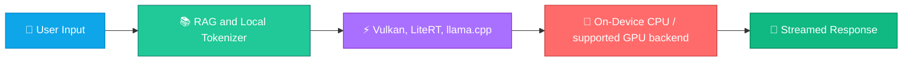

<div align="center">


# Solus

### A private AI workspace. Right on your Android phone.

Chat, write, code, and ask questions about your documents with AI running on your device.

**Bring your own models. Keep your conversations local. Go offline when you want.**

Solus brings model imports, document search, image and audio inputs, and conversation tools into one open-source Android app.

<br/>

<!-- Custom glass-gradient download CTA (docs/assets/download-solus-apk.svg) -->
<p>
  <a href="https://github.com/ShounakPatra/Solus/releases/download/v6.0.0/app-release.apk" title="Download Solus v6.0.0 APK">
    
  </a>
</p>

<p>
  <sub>v6.0.0 · 39.85 MB (38.00 MiB) · Android 9.0+ · ARM64</sub>
</p>

<p>
  
  
  
  
  
</p>

<p>
  
  
  
</p>

<p align="center">
  <a href="https://trendshift.io/repositories/156746" target="_blank" rel="noopener noreferrer">
    
  </a>
</p>

**🔒 Offline conversations &nbsp;•&nbsp; 🧩 Bring your own models &nbsp;•&nbsp; 📚 Ask your documents**

[Get started](#get-started) · [Explore features](#features) · [What's new](#whats-new) · [Roadmap](#roadmap) · [Build from source](#build-from-source)

</div>

---

## 📱 App Preview

<p align="center">
  
  &nbsp;&nbsp;
  
  &nbsp;&nbsp;
  
</p>

<p align="center">
  <sub><b>Private chat</b> · <b>Model manager</b> · <b>Resumable downloads</b></sub>
</p>

---

<a id="features"></a>

## ✨ An AI workspace that fits the way you work

| What you want to do | How Solus helps |
|---|---|
| **Use the model you choose** | Download from the catalog or import compatible GGUF, LiteRT-LM and MediaPipe models from your phone, Hugging Face or a URL. |
| **Keep conversations local** | Run inference on your device. Use temporary chats when you do not want a conversation saved to history or memory. |
| **Understand your documents** | Ask questions about PDFs, DOCX, text and code, then inspect the retrieved source passages. |
| **Write, learn and code** | Switch personas, use prompt shortcuts, view formatted code and math, and edit prompts or regenerate replies. |
| **Work with images and audio** | Attach photos, use the camera or record audio with a model that supports the input. |
| **Keep your workspace organised** | Search, pin and rename chats; save per-model profiles; back up chats, memories and settings. |
| **Make it feel like yours** | Enjoy floating glass controls, model-inspired colours, reduced-motion options and larger touch targets. |

Models run locally; downloading models, checking updates and opening external links use the network. Input capabilities and performance depend on the selected model and device.

---

<a id="get-started"></a>

## 📥 From download to your first conversation

1. **Install Solus.** Download [`app-release.apk` for v6.0.0](https://github.com/ShounakPatra/Solus/releases/download/v6.0.0/app-release.apk) and open it on your phone. Allow installation from that source if Android asks.
2. **Choose your model.** Open **Models** to download from the catalog, or tap **Add model** to import a compatible file from your phone, Hugging Face or a URL.
3. **Make it yours.** Select the model, wait for initialization, then start a conversation. Try a persona, attach a document, or turn on temporary chat before your first message.

**Choosing your first model?** Start with a small text model that fits your phone's available RAM. Choose a vision or audio-capable model when you need those inputs.

**Requirements:** Android 9.0+ (API 28+), ARM64-v8a device. Model weights require additional storage; RAM needs depend on the model.

The signed **v6.0.0 APK is available** in the [release assets](https://github.com/ShounakPatra/Solus/releases/tag/v6.0.0). Its published size and SHA-256 match the verified release file. See the [release verification details](docs/releases/v6.0.0.md#apk-verification).

---

<a id="whats-new"></a>

## 🆕 What’s New in **v6.0.0**

**Shipped: v6.0.0** · Android version code **9**. This release brings custom model imports and a more complete private workspace to Solus.

- **Bring your own models.** Import compatible `.gguf`, `.litertlm`, and `.task` files from your phone, Hugging Face or a direct URL. Supported GGUF bundles can include split shards and companion projectors.
- **A model library that stays organised.** Browse catalog downloads and imported models together, filter your imports, and pause or resume remote downloads.
- **More control over every conversation.** Search, pin and rename chats, edit a prompt, regenerate a reply, or start a temporary chat that skips saved history and memory.
- **A workspace you can take with you.** Back up and restore chats, memories, settings and optional available attachments. Save custom instructions and supported settings for each model.
- **Follow the answer back to its sources.** Inspect retrieved document passages and see estimated context use against the initialized model's actual capacity.
- **Clearer thinking and smoother interaction.** Separate reasoning from answers on supported models, with improved streaming, Stop handling and capability detection.
- **A refreshed glass interface.** Floating controls, colourful personas, scrollable suggestions, tidier history menus, accessibility options and fast, bouncy navigation.
- **Safer recovery.** Stronger checks help protect saved chats and knowledge data, while model-loading and shutdown guards improve recovery from failed operations.

[Read the full v6.0.0 release notes →](docs/releases/v6.0.0.md) · [See what's planned for v6.0.5 →](#roadmap)

Backups exclude model weights, access tokens and document indexes. Model compatibility and speed vary by file and phone.

**Build validation:** [Android CI passed for commit `e9a01c0`](https://github.com/ShounakPatra/Solus/actions/runs/39578235174), including native tests, unit tests, lint, instrumentation-test compilation, debug/release builds and APK packaging checks. CI does not execute inference on a physical phone.

---

<details>
<summary><b>🛠️ Built with Kotlin, Compose and local inference runtimes</b></summary>

<div align="center">

| Layer | Stack |
|---|---|
| Language | **Kotlin 2.4.20** & **C++17** |
| UI Framework | **Jetpack Compose**, Material 3, Haze Glass Blur |
| Inference Backends | **llama.cpp JNI (CPU + Vulkan)**, **LiteRT-LM 0.18.0**, **MediaPipe GenAI 0.10.35** |
| Retrieval (RAG) | Local Vector Embeddings, Cosine Similarity, In-Memory Index |
| Math Engine | `com.hrm.latex` |
| Media & Audio | Android `AudioRecord` (16kHz PCM16 Mono), `MediaPlayer`, `PdfRenderer` |
| Local State | **SharedPreferences** & Private File Storage |

</div>

</details>

---

## 💬 Start with something useful

| Try this | Example prompt |
|---|---|
| **Learn something new** | “Explain quantum computing using a simple everyday analogy.” |
| **Make a document easier to read** | Attach a document: “Summarise the key ideas and show the relevant source passages.” |
| **Review your code** | Paste a snippet: “Find likely bugs and explain how you would fix them.” |
| **Find the words** | “Turn these notes into a clear, friendly message.” |
| **Explore a photo** | With a compatible vision model: “Describe what you can see in this image.” |

Follow up, edit your prompt, or regenerate a reply to explore another answer.

---

## 🎯 Model Compatibility Guide

<div align="center">

| Model format | Runtime | How to add it |
|---|---|---|
| **`.gguf`** | llama.cpp, with CPU and Vulkan options | Catalog, phone storage, Hugging Face or URL; supported bundles may include split shards and companion projectors. |
| **`.litertlm`** | LiteRT-LM | Compatible catalog artifacts or phone/URL imports. |
| **`.task`** | MediaPipe GenAI | Compatible catalog artifacts or phone/URL imports. |

</div>

> GGUF is a container format, not a compatibility guarantee. Supported architectures and quantizations depend on the bundled llama.cpp integration, available RAM, device drivers and any required companion projector. Importing a file does not guarantee it will initialize successfully.

Start with a smaller text model that fits your available RAM. Image and audio inputs require a compatible model and artifact; support is not implied by the file extension.

---

<details>
<summary><b>📂 Explore the project structure</b></summary>

```text
Solus
├── app/
│   ├── src/main/
│   │   ├── cpp/                # llama.cpp native sources & JNI bridge (CPU + Vulkan)
│   │   ├── java/com/shounak/localmeshai/
│   │   │   ├── ai/             # Inference managers (Chat, Vision, llama.cpp JNI)
│   │   │   ├── models/         # Model catalog, downloaders & ratings
│   │   │   ├── rag/            # Local RAG vector store, chunking & retrieval
│   │   │   ├── ui/             # Compose screens, components, theme & viewmodels
│   │   │   └── utils/          # AppUpdateManager, AudioUtils, AttachmentViewer, Glass
│   │   └── res/                # XML layouts, file providers, icons, mipmaps
│   └── build.gradle.kts
├── gradle/libs.versions.toml
└── README.md
```

</details>

---

<details>
<summary><b>🏗️ How local inference works</b></summary>

Supported text, vision and audio inference and document retrieval run locally. Downloading models, checking updates and opening external links are separate network operations:


<p align="center">
  <sub><b>Supported Inputs:</b> Text prompts · Microphone audio · Camera & images · Local documents (PDF, DOCX, TXT)</sub>
</p>

</details>

---

<a id="build-from-source"></a>

## 🛠️ Build from Source

Solus is open source under Apache 2.0. Browse the code, report a reproducible issue, or help improve the Android experience.

[Contributing guide](CONTRIBUTING.md) · [Report an issue](https://github.com/ShounakPatra/Solus/issues) · [Security policy](SECURITY.md)

<details>
<summary><b>Toolchain, build commands and APK locations</b></summary>

**Requirements**: Android Studio compatible with the configured Android Gradle Plugin (**9.4.1**) · Android SDK **37** · NDK **28.2.13676358** · CMake **3.22.1**. Use Android Studio's bundled JBR for Gradle; Kotlin/Java bytecode targets Java 17. The project uses the checked-in **Gradle 9.8.2** wrapper.

Keep `local.properties` and signing credentials local. Configure your own `keystore.properties` for a signed release; never commit private signing keys.

```bash
git clone https://github.com/ShounakPatra/Solus.git
cd Solus

# Build debug APK
./gradlew assembleDebug

# Run all unit tests
./gradlew testDebugUnitTest

# Build signed release APK
./gradlew assembleRelease
```

Release APK path: `app/build/outputs/apk/release/app-release.apk`  
Debug APK path: `app/build/outputs/apk/debug/app-debug.apk`

</details>

---

## 🔒 Your conversations stay on your device

Inference runs locally, so you can keep chatting without an internet connection once your model is available. Solus does not use analytics or tracking.

- **Choose what gets saved.** Keep conversation history and useful memories, or start a temporary chat that skips both.
- **Choose what leaves your phone.** Export a backup or share content when you decide to.
- **Keep download credentials separate.** Optional Hugging Face tokens are stored in app-private preferences and excluded from portable backups.

Model downloads, update checks and external links use the network. Models can live in app storage or user-selected locations; backups go to the location you choose. Read [SECURITY.md](SECURITY.md) for security details.

---

## 💡 FAQ

<details>
<summary><b>Does Solus run fully offline?</b></summary>
<br/>

Yes! Once a model is downloaded to your device, you can completely turn off Wi-Fi and mobile data. All chat inference, document querying, and audio processing occur 100% locally.

</details>

<details>
<summary><b>How does local Document RAG work?</b></summary>
<br/>

When you attach a file (PDF, TXT, DOCX, etc.), Solus splits the document into text chunks and generates on-device embeddings. When you ask a question, Solus performs cosine similarity matching to inject relevant document chunks directly into the model's context window.

</details>

<details>
<summary><b>Which GGUF models are currently supported?</b></summary>
<br/>

Compatible GGUF models can be downloaded from the catalog or imported from phone storage, a direct URL or a Hugging Face repository. Support depends on the bundled runtime, model architecture, quantization, available memory and companion projectors. CPU and Vulkan options are available; GPU correctness and performance vary by device.

</details>

<details>
<summary><b>How does the in-app updater work?</b></summary>
<br/>

Solus periodically checks the official GitHub repository releases API. When a new version is detected, you receive an in-app prompt with changelog details and can download and install the new APK directly.

</details>

<details>
<summary><b>How do I access gated models like Gemma 3?</b></summary>
<br/>

Go to **Settings** → **Hugging Face Access Token** and enter your read token. You can use the built-in video tutorial guide button for assistance in generating one.

</details>

---

<a id="roadmap"></a>

## 🗺️ Roadmap

<div align="center">

| Version | Status | Highlights |
|---|:---:|---|
| **v1.0.0 – v1.2.0** | ✅ Shipped | Core local chat, thinking controls, resumable downloads, directional tab motion |
| **v1.5.0** | ✅ Shipped | Full Settings menu, dynamic model themes, auto-hide nav, high-tech downloading cards, telemetry guard |
| **v2.0.0** | ✅ Shipped | **Vulkan GPU compute**, **Local RAG document search**, **Audio & Voice input**, **In-App GitHub Auto-Updater** |
| **v3.0.0** | ✅ Shipped | Native packaging improvements, offline privacy, persistent memory and thinking controls |
| **v5.0.0** | ✅ Shipped | Response finalization, transactional model management, resumable downloads, document extraction safety and signed-update verification |
| **v6.0.0** | ✅ Shipped | Phone storage imports, split GGUF models and projectors, workspace backups, conversation tools, per-model profiles, and floating controls |
| **v6.0.5** | 🔜 Planned | Runtime upgrades, faster GGUF responses, backend qualification and more responsive loading |

</div>

### Next release: v6.0.5

The next planned release focuses on **faster GGUF responses, upgraded llama.cpp and LiteRT-LM runtimes, and smoother model loading**. The items below are targets, with no fixed delivery date. They remain planned until implementation and device testing are complete.

<details>
<summary><b>Explore the v6.0.5 implementation roadmap</b></summary>

### Current baseline

- App source: **6.0.0**, Android version code **9**.
- LiteRT-LM Android dependency: **0.18.0**, configured in `gradle/libs.versions.toml`.
- llama.cpp integration declares upstream pin **5cdadfc326163ed1fa66cf609fb1761f7928900c** in `app/src/main/cpp/CMakeLists.txt`. This records the configured pin; it does not establish that the vendor tree is unmodified or that it is the newest upstream revision.
- MediaPipe GenAI dependency: **0.10.35**.
- Current features and repairs: [v6.0.0 release notes](docs/releases/v6.0.0.md).

### Already implemented in v6.0.0 source

- [x] CPU-only backend configuration disables GPU devices, GPU layers, KQV offload and operation offload, with runtime isolation inspection.
- [x] Auto selection defaults to CPU unless numerical validation and a qualifying performance receipt permit Vulkan.
- [x] A user-started CPU/GPU benchmark runs cold/warm inference and records latency and throughput results; it is not just a placeholder button.
- [x] Performance receipts are keyed by model, native build, device and execution settings.
- [x] Runtime ownership, handoff, shutdown guards and cancellation coordination are present.
- [x] Loading stages and an elapsed-time ticker are present, including runtime waiting.
- [x] Text GGUF generation supports prompt-prefix/KV reuse, with cache reset paths and reuse disabled for multimodal requests.
- [x] Trace instrumentation and inference timing/metrics are present.

These are source implementations. Their presence does not establish a speed improvement or complete device coverage for every model and phone.

### v6.0.5: Upgrade inference runtimes

- [ ] Evaluate a newer llama.cpp revision against the configured baseline, preserving local Android, JNI, Vulkan and multimodal repairs.
- [ ] Evaluate a newer stable LiteRT-LM Android release against **0.18.0**, checking streaming, thinking, initialization, cache and native-library compatibility.
- [ ] Revalidate MediaPipe interaction and 16 KB native-library compatibility after upgrades.
- [ ] Record the selected pins, device results, known limitations and rollback options.

### v6.0.5: Improve measured GGUF performance

- [ ] Use the existing benchmark and profiling tools to establish reproducible physical-phone baselines for prompt processing, time to first token, decode speed, RAM and thermals.
- [ ] Tune measured bottlenecks in thread counts, batching, context allocation and CPU/Vulkan overhead.
- [ ] Evaluate further cache and execution-profile improvements beyond the prompt reuse already implemented.
- [ ] Compare before/after runs with the same model, prompt, settings and thermal conditions, preserving correctness, responsiveness and cancellation.

### v6.0.5: Strengthen validation and diagnostics

- [ ] Audit CPU isolation across all initialization, validation and fallback paths and confirm it with physical-device traces.
- [ ] Exercise existing runtime guards under rapid model switching, cancellation during native initialization, failed cleanup and stale completions.
- [ ] Audit benchmark measurements and qualification thresholds. Distinguish token-callback intervals from actual UI frame timing before treating results as evidence of rendering responsiveness.
- [ ] Expand device/model coverage for existing Auto selection and benchmark receipts.
- [ ] Improve phase-specific timing and synchronized Logcat/Perfetto capture using the existing instrumentation.

### Release validation

- [ ] Run focused regressions for changed behavior and required release checks.
- [ ] Verify the exact signed APK's identity, version, signature and DEX integrity.
- [ ] Test startup/upgrade, imports, text/vision generation, thinking, Stop, model switching, temporary-chat privacy, backup/memory restore and deletion followed by restart.
- [ ] Check large fonts, keyboard plus media menu, reduced motion and navigation on physical phones.
- [ ] Publish measured improvements and tested combinations. No speed multiplier is promised before measurement.

</details>

---

## 👤 Author

**Shounak Patra**  
GitHub: [@ShounakPatra](https://github.com/ShounakPatra)  
Email: [shounakpatra68@gmail.com](mailto:shounakpatra68@gmail.com)

---

## 📄 License

Solus is licensed under the **Apache License 2.0**. See [LICENSE](LICENSE) for details.

---

<div align="center">

**Take your next conversation offline.**

<p>
  <a href="https://github.com/ShounakPatra/Solus/releases/download/v6.0.0/app-release.apk" title="Download Solus v6.0.0 APK">
    
  </a>
</p>

Enjoy using Solus? [Star the project](https://github.com/ShounakPatra/Solus) to help others discover it, or [share feedback](https://github.com/ShounakPatra/Solus/issues) to help shape what comes next.

</div>
